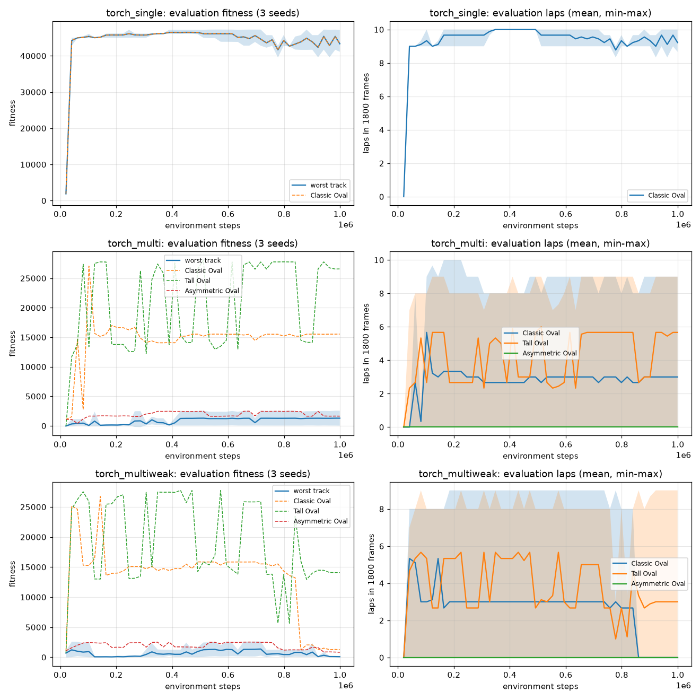
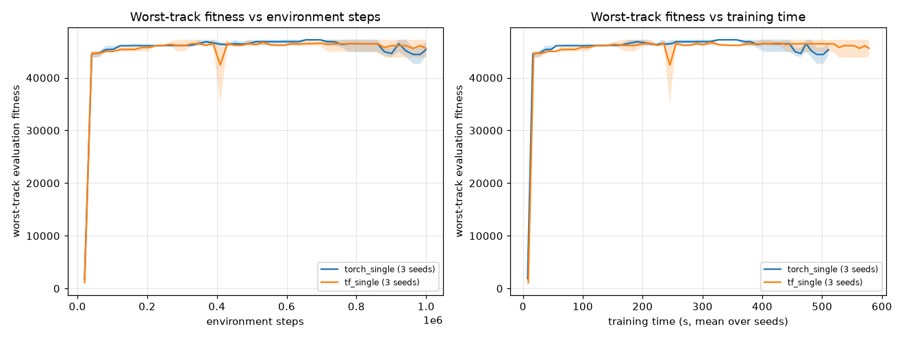
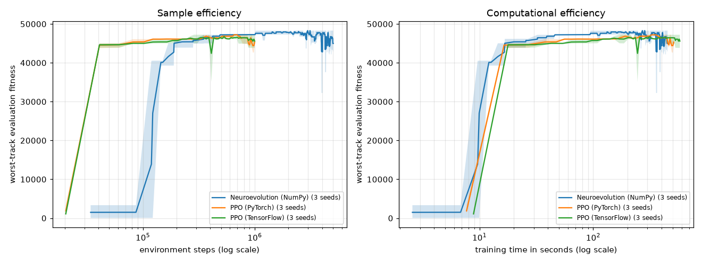
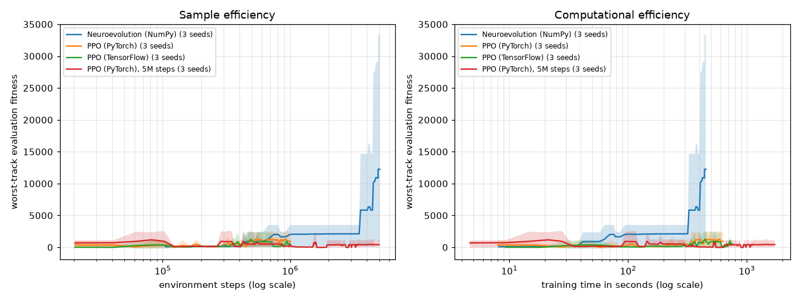
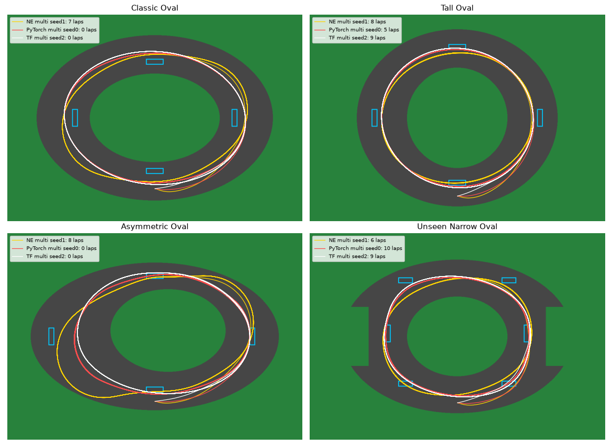

# 🏎️ AI Racing Lab

AI Racing Lab is a 2D autonomous driving simulation built with **Python, Pygame, and NumPy**. A population of neural-network-controlled cars learns to navigate a racing track through **neuroevolution**: fitness evaluation, selection, crossover, mutation, and elitism.

The current policy uses **continuous steering and throttle control**, learning both how to turn and how much to accelerate from five distance sensors and the car's current speed.

The project began with a rule-based controller and has grown into an experimental environment for studying autonomous agents, evolutionary optimization, and driving performance.

The simulation is now also exposed as a **Gymnasium environment** (`AIRacing-v0`), the foundation for training **reinforcement-learning** agents with PyTorch and TensorFlow and comparing them with neuroevolution under identical conditions. See [Reinforcement-learning environment](#reinforcement-learning-environment).

A **PPO agent in PyTorch** is trained in that environment. On the original track it matches the neuroevolution champion (10 laps) after a fraction of the simulation steps. See [PPO agent in PyTorch](#ppo-agent-in-pytorch).

The same PPO agent is also implemented in **TensorFlow / Keras**. Tests show that both implementations compute identical gradients, and both learn identically. They differ mainly in speed profile. See [PPO in TensorFlow and framework comparison](#ppo-in-tensorflow-and-framework-comparison).

Finally, all three approaches are compared from scratch under equal conditions. PPO needs 4.6× fewer simulation steps on a single track, while neuroevolution is just as fast in wall-clock time. On three tracks, neuroevolution's exploration produced the only model that laps all of them. See [Final comparison: neuroevolution vs PPO](#final-comparison-neuroevolution-vs-ppo).

## Contents

- [Features](#features)
- [Getting started](#getting-started)
- [Controls and operating modes](#controls-and-operating-modes)
- [Observations and neural network](#observations-and-neural-network)
- [Vehicle and track](#vehicle-and-track)
- [Neuroevolution](#neuroevolution)
- [Fitness and progress](#fitness-and-progress)
- [Adaptive mutation](#adaptive-mutation)
- [Model persistence](#model-persistence)
- [Training history and plotting](#training-history-and-plotting)
- [Project structure](#project-structure)
- [Configuration](#configuration)
- [Development findings](#development-findings)
- [Reinforcement-learning environment](#reinforcement-learning-environment)
- [PPO agent in PyTorch](#ppo-agent-in-pytorch)
- [PPO in TensorFlow and framework comparison](#ppo-in-tensorflow-and-framework-comparison)
- [Final comparison: neuroevolution vs PPO](#final-comparison-neuroevolution-vs-ppo)
- [Tests](#tests)
- [Roadmap](#roadmap)

## Features

- Custom Pygame racing environment with real-time visualization
- Basic vehicle physics with acceleration, friction, rotation, and a speed limit
- Track-boundary collision detection
- Five ray-casting distance sensors
- A small feed-forward neural network implemented directly in NumPy
- Continuous steering and neural-network-controlled throttle
- Population-based training with fitness-based parent selection
- Elitism, crossover, multiple mutation strengths, and random agents
- Stagnation detection and adaptive mutation
- Ordered checkpoints, lap counting, and continuous progress rewards
- Separate **TRAIN** and **DEMO** modes
- Automatic saving and loading of the best model
- Lap timing in DEMO mode
- Per-generation CSV history and Matplotlib training plots
- Gymnasium environment (`AIRacing-v0`) with headless, NumPy-based sensors
- Bit-for-bit parity between the RL environment and the original simulation, enforced by tests
- PPO agent in PyTorch with shared, framework-independent training and evaluation code
- The same PPO agent in TensorFlow / Keras 3, with tests proving gradient-level equivalence
- Framework benchmark: sample efficiency, wall-clock time and per-operation cost
- Headless neuroevolution with exact step counting and an automated three-way comparison report
- Multi-seed experiments, learning curves and comparison tables against neuroevolution
- Pytest test suite

## Getting started

### Requirements

- Python 3 and `pip`
- A desktop environment capable of displaying a Pygame window
- Pygame, NumPy, and Matplotlib

Download or clone this repository, then open a terminal in the `ai-racing-lab` directory containing `main.py`.

Create a virtual environment:

```sh
python -m venv .venv
```

Activate it on **Windows PowerShell**:

```powershell
.\.venv\Scripts\Activate.ps1
```

Or on **macOS / Linux**:

```sh
source .venv/bin/activate
```

Install the dependencies:

```sh
python -m pip install pygame numpy matplotlib
```

Run the simulation:

```sh
python main.py
```

The application starts in TRAIN mode. Let at least one generation finish so that generation statistics and a model can be saved. Press `TAB` to watch the saved model in DEMO mode.

To visualize recorded training history:

```sh
python plot_training.py
```

Run these commands from the project directory so relative model and history paths resolve consistently.

### Reinforcement-learning extension

The RL environment and tests need a few extra packages. The neuroevolution simulation above does not require them.

```sh
python -m pip install -r requirements-rl.txt
```

For development and tests:

```sh
python -m pip install -r requirements-dev.txt
```

| File | Contents |
|---|---|
| `requirements.txt` | Pygame, NumPy, Matplotlib (neuroevolution simulation) |
| `requirements-rl.txt` | The above plus Gymnasium |
| `requirements-dev.txt` | The above plus pytest |
| `requirements-torch.txt` | `requirements-rl.txt` plus PyTorch |
| `requirements-tf.txt` | `requirements-rl.txt` plus TensorFlow |

## Controls and operating modes

| Control | Action |
|---|---|
| `TAB` | Switch between TRAIN and DEMO |
| `R` | Restart the current mode |
| Window close button | Exit the application |

### TRAIN

TRAIN mode evaluates a population of cars on the same track. Each car has its own neural network. At the end of a generation, the simulation ranks the population and creates the next generation.

Training ends a generation when all cars have crashed or the generation frame budget is exhausted. The default budget is **1,800 frames**.

The interface displays live driving and training information, including generation, living agents, fitness, checkpoints, laps, speed, steering, throttle, mutation mode, and stagnation count. The leading agent is highlighted in yellow.

Restarting TRAIN mode creates a fresh random population. Archive any model and history you want to preserve before running a separate experiment; restarting the population is not the same as managing experiment files.

### DEMO

DEMO mode loads `best_brain_continuous.npz` and runs one autonomous car. It performs inference only: observations pass through the saved network to produce steering and throttle, with no selection or mutation.

DEMO mode tracks lap times. A saved continuous-control model must exist before DEMO can start. Use `R` to restart the demo car.

## Observations and neural network

The policy receives **local observations**, not absolute coordinates, a track map, or the location of the next checkpoint.

Five rays measure the distance to a track boundary:

```text
left_far    left    front    right    right_far
     \        \      |      /        /
      \        \     |     /        /
                    CAR
```

The observation vector contains normalized sensor distances and normalized speed:

```text
[left_far, left, front, right, right_far, speed]
```

### Architecture

```text
5 distance sensors + current speed
                |
            6 inputs
                |
      8 hidden neurons, tanh
                |
       2 outputs, tanh
                |
       steering + throttle
```

The network contains **74 trainable parameters**:

| Parameter | Shape | Count |
|---|---|---:|
| Input-to-hidden weights | `6 × 8` | 48 |
| Hidden biases | `8` | 8 |
| Hidden-to-output weights | `8 × 2` | 16 |
| Output biases | `2` | 2 |

For an observation vector `x`, the forward pass is:

```text
hidden = tanh(x @ W1 + b1)
output = tanh(hidden @ W2 + b2)

steering = output[0]
throttle = (output[1] + 1) / 2
```

| Output | Range | Meaning |
|---|---|---|
| Steering | `[-1, 1]` | Negative turns right; positive turns left; zero keeps heading |
| Throttle | `[0, 1]` | Zero applies no throttle; one applies maximum throttle |

Reduced throttle allows friction to slow the vehicle. Throttle is not a separate brake or reverse command.

The network is intentionally small enough to inspect and evolve without a large machine learning framework. It is trained through evolutionary search, **not backpropagation**.

## Vehicle and track

The environment uses a simple oval track with inner and outer grass boundaries. Cars accelerate, rotate, and move according to their current controls. Sensors and collision checks sample the rendered track.

Checkpoints must be visited in order. With the current starting position at the bottom of the track, facing right, the sequence is:

```text
right → top → left → bottom → repeat
```

Completing the checkpoint sequence increments the lap count. Checkpoint tracking supplies evaluation information to the training system; checkpoint coordinates are not neural-network inputs.

This is a simplified driving simulation, with no detailed tire, suspension, or aerodynamic model.

## Neuroevolution

Each generation follows this cycle:

1. Run the population using each car's neural network.
2. Measure driving progress and calculate fitness.
3. Rank agents by fitness.
4. Save a new best model when the improvement condition is met.
5. Copy elite networks unchanged into the next generation.
6. Select high-fitness parents and combine their parameters through crossover.
7. Mutate offspring using a mixture of mutation strengths.
8. Introduce random agents to maintain diversity.
9. Reset vehicle states and evaluate the new population.

```text
Population → Driving → Fitness → Selection
    ↑                               |
    └── Elites + Mutated offspring + Random agents
```

Elitism preserves successful network parameters while mutation and random agents search for different strategies. A new car starts each evaluation from the initial vehicle state, even when it inherits an elite network.

## Fitness and progress

The fitness objective rewards progress around the track. Its components include checkpoint progress, continuous progress toward the next checkpoint, speed, and a small survival contribution.

- **Checkpoints:** provide a strong signal for completing the route in order.
- **Continuous progress:** measures changes in distance to the next checkpoint, providing feedback between checkpoint crossings.
- **Speed:** encourages useful forward motion alongside route completion.
- **Survival:** contributes a small reward for remaining active.
- **Collisions:** stop the car's evaluation and prevent further progress and reward accumulation.

The scoring implementation in `main.py` is the source of truth for numerical weights and any explicit penalties. Fitness is an optimization score, not a lap time or a universal measure of driving quality.

## Adaptive mutation

The system tracks generations without a meaningful improvement in best fitness. Longer stagnation increases exploration through stronger mutations and more random agents.

| Mode | Purpose |
|---|---|
| `FINE` | Refine successful policies with smaller changes |
| `EXPLORE` | Broaden the search after sustained stagnation |
| `ESCAPE` | Apply stronger changes after longer stagnation |

The current stagnation thresholds are **8** and **18** generations, with `MIN_IMPROVEMENT = 1.0` defining the improvement threshold. Elites remain protected as exploration increases.

A falling population average does not necessarily mean the best policy is getting worse: stronger mutations can produce many weak candidates while elites retain strong behavior. Inspect best fitness, average fitness, laps, and mutation mode together.

Adaptive mutation does not guarantee escape from a plateau. The action space, fitness function, track geometry, speed limit, and frame budget can also constrain performance.

## Model persistence

The continuous-control model is saved to:

```text
best_brain_continuous.npz
```

The NumPy archive stores both layers' weights and biases. A saved model can be loaded for DEMO inference or used to seed further evolution when the application starts.

This preserves a policy, not a complete training-session checkpoint: network parameters alone do not restore the full population, generation counters, or random-number state.

### Compatibility with the earlier controller

The earlier discrete policy selected `LEFT`, `STRAIGHT`, or `RIGHT` and used automatic throttle. Its output layer had three neurons and its model file was `best_brain.npz`.

The current policy has two outputs. **The old and new model architectures are incompatible.** Keep the separate filenames; renaming an old archive does not convert it to continuous control.

## Training history and plotting

Each completed generation records statistics in:

```text
training_history_continuous.csv
```

The recorded metrics include:

| Metric | What it describes |
|---|---|
| Generation | Generation index |
| Best fitness | Fitness of the generation's champion |
| Average fitness | Mean fitness across the population |
| Best checkpoints | Champion's checkpoint count |
| Best laps | Champion's completed laps |
| Frames alive | Champion's active frame count |
| Champion average speed | Speed summary for the champion |
| Stagnation | Generations without meaningful improvement |
| Mutation mode | Current adaptive evolution mode |

`plot_training.py` uses Matplotlib to visualize best and average fitness, best laps, and champion average speed across generations.

### Reading the plots

- Rising best fitness suggests the search is finding better-scoring policies.
- Rising average fitness suggests improvement across more of the population.
- Stable best fitness with a fluctuating average can reflect exploration around a retained champion.
- A stable lap count may indicate a limit imposed by the track and evaluation budget, or a policy that has stopped improving.

Keep separate history files for separate experiments. If the plotting script still targets the earlier `training_history.csv`, update its input to the continuous-control history and use the matching CSV columns.

For a fair comparison, keep track layout, frame budget, physics, and scoring consistent. Do not compare raw fitness values from different scoring functions as if they were equivalent.

## Project Structure

```text
ai-racing-lab/
│
├── brain.py
│   Neural-network policy, mutation, crossover,
│   model saving and loading.
│
├── car.py
│   Vehicle physics, neural control, raycast sensors,
│   collision detection, checkpoints and lap tracking.
│
├── main.py
│   Multi-track neuroevolution training loop,
│   adaptive mutation, selection, elitism and demo mode.
│
├── tracks.py
│   Definitions of training tracks, start positions
│   and checkpoint layouts.
│
├── evaluate_model.py
│   Evaluates the single-track continuous model
│   on the original training environment.
│
├── evaluate_multitrack_model.py
│   Evaluates the multi-track model across all
│   training environments.
│
├── evaluate_unseen_track.py
│   Evaluates a trained model on a previously
│   unseen track to measure generalization.
│
├── plot_training.py
│   Visualizes training metrics with Matplotlib.
│
├── results/
│   Selected experiment summaries and evaluation results.
│
│   ├── single_track_evaluation.txt
│   ├── unseen_track_single_model.txt
│   ├── multitrack_evaluation.txt
│   ├── unseen_track_multitrack_model.txt
│   ├── training_summary.md
│   └── rl/                RL results: tables, curves, summaries
│
├── envs/
│   Gymnasium environment for reinforcement learning.
│
│   ├── __init__.py        registers AIRacing-v0
│   ├── track_geometry.py  headless grass masks, unseen track, track sets
│   ├── env_car.py         EnvCar: external controls, vectorized sensors
│   ├── racing_env.py      RacingEnv: spaces, reward, termination, render
│   ├── brain_policy.py    run a neuroevolution Brain in the environment
│   ├── demo.py            watch a policy drive
│   └── benchmark.py       simulation speed comparison
│
├── rl/
│   Reinforcement-learning agents.
│
│   ├── common.py          PPOConfig, VecEnv, buffer, GAE, track sampler
│   ├── trainer.py         framework-independent PPO loop and CLI
│   ├── ppo_torch.py       PyTorch actor-critic agent
│   ├── ppo_tf.py          TensorFlow / Keras actor-critic agent
│   ├── benchmark_frameworks.py  per-operation framework timing
│   ├── neuroevolution.py  headless NE (main.py's algorithm) with step counting
│   ├── report.py          final NE / PyTorch / TensorFlow comparison
│   ├── plot_trajectories.py  driven paths of saved models on every track
│   ├── evaluate.py        one evaluator for every model type
│   ├── compare.py         multi-model Markdown comparison tables
│   └── plot_runs.py       learning curves across seeds
│
├── tests/
│   Pytest suite: geometry, parity with the original
│   simulation, environment behavior and PPO components.
│
├── requirements.txt
│   Neuroevolution dependencies.
│
├── requirements-rl.txt / requirements-dev.txt
│   requirements-torch.txt / requirements-tf.txt
│   Extra dependencies for RL, tests, PyTorch and TensorFlow.
│
├── pytest.ini
│   Test discovery settings.
│
├── .gitignore
│   Excludes virtual environments, caches,
│   trained model files and generated histories.
│
└── README.md
    Project documentation and experimental results.
```

Model archives (`*.npz`, `*.pt`), generated training histories (`training_history*.csv`) and RL runs (`runs/`) are ignored by Git. The summaries in `results/` are kept under version control.

## Configuration

The current main simulation settings are defined in `main.py`:

| Setting | Default | Purpose |
|---|---:|---|
| `WIDTH`, `HEIGHT` | `1000`, `700` | Window dimensions |
| `FPS` | `60` | Target display/update rate |
| `POPULATION_SIZE` | `40` | Cars evaluated per generation |
| `PARENT_COUNT` | `5` | Top agents used as parents |
| `ELITE_COUNT` | `2` | Networks copied unchanged |
| `MAX_FRAMES_PER_GENERATION` | `1800` | Maximum generation length |
| `STAGNATION_LEVEL_1` | `8` | First exploration threshold |
| `STAGNATION_LEVEL_2` | `18` | Stronger exploration threshold |
| `MIN_IMPROVEMENT` | `1.0` | Minimum meaningful fitness improvement threshold |

Vehicle parameters live in `car.py`; network dimensions and operations live in `brain.py`. Changing network dimensions requires a compatible saved model or a new training run.

## Development findings

The project has evolved through the following stages:

```text
Rule-based driving
  → Discrete neural control
  → Population training and neuroevolution
  → Model persistence and DEMO mode
  → CSV metrics and plots
  → Stagnation detection and adaptive mutation
  → Continuous steering and throttle
```

The earlier policy could choose steering direction but could not directly adjust throttle. Its observed plateau motivated expanding the action space so the agent could learn trajectory and acceleration together.

Development plots discussed after the continuous-control update showed rapid progress to stable multi-lap driving, with best laps reaching approximately **10** and best fitness approaching **48,000** in that run. These are informal observations from a development run, not a repeated benchmark or proof of generalization.

A controlled comparison with the discrete policy remains planned. Evaluation should report lap times, crashes, speed, and completed laps under the same conditions, rather than relying on training fitness alone.

## Evaluation Results

The best continuous-control model was evaluated over 10 episodes with small random perturbations to the starting position and heading.

| Metric | Result |
|---|---:|
| Episodes | 10 |
| Average laps | 10.00 |
| Best laps | 10 |
| Worst laps | 10 |
| Average checkpoints | 41.30 |
| Average frames | 1800.00 |
| Average normalized speed | 0.985 |
| Crash rate | 0.0% |

The model completed all evaluation episodes without crashing while maintaining nearly maximum average speed.

This indicates that the learned policy is highly stable on the training track and robust to small perturbations in the initial state.

## Generalization Experiment

The continuous-control model achieved perfect stability on the training track:

- 10.0 average laps
- 0% crash rate
- 0.985 normalized average speed

However, evaluation on an unseen track revealed poor generalization:

- 0.0 average laps
- 0.5 average checkpoints
- 50% crash rate
- 0.502 normalized average speed

This indicates that the learned policy strongly overfit to the geometry of the training environment.

> **Correction.** These unseen-track numbers were later found to be dominated by two defects in the unseen track itself: a start position touching the grass and side checkpoints placed on the grass. See [Fixing the unseen track](#fixing-the-unseen-track) for corrected results.

The next stage of the project focuses on multi-track training and domain randomization to improve generalization.

## Single-Track Model Evaluation

The continuous-control model trained on the original track was evaluated over 10 episodes with small perturbations to the starting position and heading.

| Metric | Result |
|---|---:|
| Episodes | 10 |
| Average laps | 10.00 |
| Best laps | 10 |
| Worst laps | 10 |
| Average checkpoints | 41.80 |
| Average frames | 1800.00 |
| Average normalized speed | 0.985 |
| Crash count | 0 / 10 |
| Crash rate | 0.0% |

The model completed all evaluation episodes without crashing while maintaining nearly maximum average speed.

This confirms that the learned policy is highly stable on the original training track and robust to small perturbations in the initial state.

## Unseen-Track Evaluation

The single-track continuous-control model was also evaluated on a different, previously unseen track.

Results over 10 episodes, before and after [fixing the unseen track](#fixing-the-unseen-track):

| Metric | Original track | Corrected track |
|---|---:|---:|
| Episodes | 10 | 10 |
| Average laps | 0.00 | 0.00 |
| Best laps | 0 | 0 |
| Worst laps | 0 | 0 |
| Average checkpoints | 0.20 | 1.00 |
| Average frames | 360.80 | 1800.00 |
| Average normalized speed | 0.211 | 0.985 |
| Crash count | 8 / 10 | 0 / 10 |
| Crash rate | 80.0% | 0.0% |

On the original track, the model failed to complete a lap and crashed in most episodes. Some episodes terminated almost immediately, which prompted a closer look at the starting position and local geometry.

On the corrected track, the model never crashes and drives around the track for the whole episode at almost maximum speed. However, it takes a tight line along the inner edge and passes inside the right-side checkpoint. Checkpoints must be visited in order, so its lap counter never advances.

The single-track policy therefore transfers its basic driving skill, staying on the road at speed, but not the racing line the checkpoint layout expects.

## Multi-Track Generalization

After observing strong overfitting to the original training track, the project was extended to multi-track neuroevolution.

The same neural policy is now evaluated on three different tracks during every generation.

Initially, fitness was defined as the average score across tracks. This caused specialization: agents could achieve high average fitness by performing extremely well on two tracks while almost completely failing on the third.

The objective was therefore changed to a maximin strategy:

```text
fitness = minimum(track_scores)
```

This makes the weakest track determine the candidate's fitness and encourages balanced behavior across environments.

In the current experiment, worst-track performance improved from approximately **2,575** to **3,546** over **35 generations**.

The current champion achieved approximately:

- **Track 1:** 3,546
- **Track 2:** 42,130
- **Track 3:** 3,816
- **Worst-track fitness:** 3,546
- **Crashes:** 0 / 3

The results show measurable progress toward generalization, although the policy still exhibits substantial performance imbalance across tracks.

## Single-Track vs Multi-Track Generalization

Both models were evaluated on the same unseen track with `evaluate_unseen_track.py` (10 episodes, `random.seed(0)`), after [fixing the unseen track](#fixing-the-unseen-track).

| Metric | Single-Track Model | Multi-Track Model |
|---|---:|---:|
| Average laps | 0.00 | **8.00** |
| Average checkpoints | 1.00 | **51.00** |
| Average frames survived | 1800.00 | 1800.00 |
| Average normalized speed | 0.985 | 0.985 |
| Crash rate | 0.0% | 0.0% |

Both models stay on the road for the full episode at almost maximum speed. The difference is the racing line:

- The **single-track model** circles close to the inner edge and misses the right-side checkpoint, so it never completes a lap.
- The **multi-track model** drives a wider line, passes every checkpoint and completes **8 laps in every episode**.

Multi-track neuroevolution with maximin fitness therefore produced a policy that generalizes to this unseen track.

The table before the fix compared 0.00 vs 0.00 laps and 80% vs 70% crash rates and suggested only modest progress. Those numbers measured the track defects rather than the policies. The original values are preserved in the result files and in the Git history.

The checkpoint result for the single-track model also shows a limitation of the metric itself. Narrow, mid-lane checkpoints reward one family of racing lines, so "laps" can understate a policy that drives safely around the track. Full-width checkpoint gates on all tracks would separate these two effects. They would change training behavior, though, so they belong in a new experiment rather than a silent fix.

### Future Work

Future work includes:

- specialist preservation
- improved crossover strategies
- randomized track generation
- evaluation on completely unseen environments
- full-width checkpoint gates, so lap counts do not depend on one racing line

## Reinforcement-learning environment

The next stage of the project compares neuroevolution with **reinforcement learning** (RL), implemented in both **PyTorch** and **TensorFlow**. A fair comparison needs every method to drive the same car, on the same tracks, with the same sensors and the same objective. The first step is therefore a standard [Gymnasium](https://gymnasium.farama.org/) environment built on top of the existing simulation, without changing it.

The neuroevolution code (`main.py`, `car.py`, `brain.py`, `tracks.py` and the evaluation scripts) is untouched. The RL environment lives in the new `envs/` package and reuses `Car` and `Track` directly.

### Design

```text
tracks.py ──► TrackGeometry ──► grass mask (NumPy, rasterized once)
                                     │
car.py ────► EnvCar(Car) ◄───────────┘   external controls, fast sensors
                 │
                 ▼
            RacingEnv (gymnasium.Env, "AIRacing-v0")
                 │
     ┌───────────┼──────────────┐
  BrainPolicy  PyTorch agent  TensorFlow agent
  (neuroevo)   (phase 2)      (phase 3)
```

| Module | Responsibility |
|---|---|
| `envs/track_geometry.py` | Draws each `Track` once on an off-screen surface and stores grass as a boolean mask. Also defines the unseen evaluation track and the `train` / `unseen` / `all` track sets. |
| `envs/env_car.py` | `EnvCar` subclasses `Car`. It receives steering and throttle from outside and casts all five sensor rays in one vectorized mask query. Checkpoints, laps, progress and drawing come from `Car` unchanged. |
| `envs/racing_env.py` | `RacingEnv`: observation and action spaces, reward, termination, track selection and rendering. |
| `envs/brain_policy.py` | Runs a saved neuroevolution `Brain` as a policy inside the environment. |
| `envs/demo.py` | Watches any policy drive in a window. |
| `envs/benchmark.py` | Compares simulation speed with the original pixel-based loop. |

### Why a grass mask instead of screen pixels?

The original simulation detects grass by reading pixels from the rendered screen with `screen.get_at`. RL training needs hundreds of thousands of steps, ideally without a window. `TrackGeometry` draws each track once with the same `Track.draw` function, then answers sensor and collision queries with array lookups.

### Observations, actions and reward

The interface is deliberately identical to the neuroevolution `Brain`, so policies from both approaches are interchangeable.

| | Shape | Range | Meaning |
|---|---|---|---|
| Observation | `(6,)` | `[0, 1]` | `[left_far, left, front, right, right_far, speed]`, normalized exactly as in `Car.neural_control` |
| Action | `(2,)` | `[-1, 1]` | `[steering, throttle_raw]`, the raw tanh outputs of `Brain`; throttle = `(throttle_raw + 1) / 2` |

**Reward** is the per-step change of the neuroevolution track fitness (`calculate_track_fitness` in `main.py`):

```text
fitness = 1000 · checkpoints + 0.5 · progress + 0.05 · speed + 0.01 · frames_alive − 100 · crashed

reward_t = (fitness_t − fitness_{t−1}) · reward_scale        (reward_scale = 0.01)
```

Because the rewards telescope, the undiscounted episode return equals `fitness × reward_scale`. RL agents optimize the same objective as the evolved population, and their scores can be compared directly.

| Episode end | Condition |
|---|---|
| `terminated` | The car hits grass or leaves the screen |
| `truncated` | `max_steps` reached (default 1,800, same as `MAX_FRAMES_PER_TRACK`) |

Each reset applies the same start noise as training and evaluation (x ±8 px, y ±4 px, heading ±4°), seeded through Gymnasium for reproducibility.

### Usage

```python
import gymnasium as gym
import envs  # registers AIRacing-v0

env = gym.make("AIRacing-v0", tracks="train")      # "train", "unseen" or "all"
observation, info = env.reset(seed=0)

terminated = truncated = False
while not (terminated or truncated):
    action = env.action_space.sample()
    observation, reward, terminated, truncated, info = env.step(action)

print(info)  # track, fitness, checkpoints, laps, frames_alive, average_speed, crashed
```

| Argument | Default | Purpose |
|---|---|---|
| `tracks` | `"train"` | `"train"`, `"unseen"`, `"all"` or a list of `Track` objects |
| `track_selection` | `"random"` | `"random"` samples a track per episode; `"cycle"` goes through them in order |
| `max_steps` | `1800` | Truncation limit |
| `randomize_start` | `True` | Apply start-position and heading noise |
| `reward_scale` | `0.01` | Multiplier for fitness deltas |
| `render_mode` | `None` | `"human"` opens a window; `"rgb_array"` returns frames |

A specific track can be forced with `env.reset(options={"track_index": i})`.

Watch a saved neuroevolution champion drive through the environment:

```sh
python -m envs.demo --policy brain --model best_brain_multitrack.npz --tracks all --episodes 4
```

### Verifying the environment

The environment is only useful for comparison if it behaves exactly like the original simulation. This is checked in three ways:

1. **Bit-for-bit parity.** `tests/test_env_car_parity.py` drives an original `Car` (pixel reads, `Brain` inside `neural_control`) and an `EnvCar` side by side for 1,800 frames on all four tracks. It uses a wall-following driver, random networks and both saved champions. Every observation and every state value (position, heading, speed, checkpoints, laps, progress, alive) must be identical on every frame.
2. **Reproducing earlier results.** In the environment, the single-track champion completes 10 laps on the Classic Oval, as in `results/single_track_evaluation.txt`. The multi-track champion's returns (×100) reproduce the per-track fitness reported in [Multi-Track Generalization](#multi-track-generalization):

   | Track | Fitness reported for the champion | Environment return × 100 (`envs.demo`, seeds 0–3) |
   |---|---:|---:|
   | Classic Oval | 3,546 | 3,535 |
   | Tall Oval | 42,130 | 42,129 |
   | Asymmetric Oval | 3,816 | 3,810 |

   Small differences come from the random start offsets.
3. **Gymnasium compliance.** The environment passes `gymnasium.utils.env_checker.check_env`.

### Performance

`python -m envs.benchmark` runs the same `Brain` for 20,000 steps per track:

| Track | Original (`screen.get_at`) | `RacingEnv` | Speed-up |
|---|---:|---:|---:|
| Classic Oval | ~6,500 steps/s | ~16,900 steps/s | 2.6× |
| Tall Oval | ~6,400 steps/s | ~16,900 steps/s | 2.6× |
| Asymmetric Oval | ~6,900 steps/s | ~17,000 steps/s | 2.5× |

The first version cast each sensor ray separately and reached only 1.2×. Casting all five rays in one `(rays × samples)` NumPy operation produced the final speed-up without changing a single result. Measured on a laptop CPU; absolute numbers vary by machine.

### Fixing the unseen track

Building the environment exposed two defects in the existing unseen track. Both made the evaluation measure the track rather than the policy.

**1. Start position on the grass edge.** The car started at `y = 600`, but the road at `x = 500` ends at `y = 609`. Facing right, the car's rear collision point sits at `y + 10`, which was already on grass. Measured through `RacingEnv` over 100 seeds, **59% of episodes crashed on the first frame** for both saved models. For the single-track model, these were all of its crashes.

**2. Side checkpoints on the grass.** The right (`x = 800..820`) and left (`x = 180..200`) checkpoints lay on the grass next to the narrowed lanes. A brute-force search counted how many collision-free car positions can touch each checkpoint:

| Track | Positions per checkpoint |
|---|---|
| Classic Oval | 49, 67, 49, 58 |
| Tall Oval | 49, 69, 49, 69 |
| Asymmetric Oval | 49, 69, 49, 69 |
| Unseen (original) | 69, **4**, 69, 69, **5**, 69 |

With only 4–5 valid positions, a full lap was practically impossible for any policy.

**Fix** (in both `evaluate_unseen_track.py` and `envs/track_geometry.py`):

| | Before | After |
|---|---|---|
| Start | `(500, 600)` | `(500, 575)`: 34 px from the outer edge, like the training tracks (29–39 px) |
| Right checkpoint | `Rect(800, 310, 20, 60)` | `Rect(725, 310, 20, 60)`: centre of the lane `x = 670..799` |
| Left checkpoint | `Rect(180, 310, 20, 60)` | `Rect(255, 310, 20, 60)`: centre of the lane `x = 200..329` |

Two tests now guard against regressions: no track may spawn the car in a collision, and every checkpoint on every track must be reachable from at least 40 positions. The corrected results are in [Unseen-Track Evaluation](#unseen-track-evaluation) and [Single-Track vs Multi-Track Generalization](#single-track-vs-multi-track-generalization).

## PPO agent in PyTorch

Phase 2 trains **Proximal Policy Optimization (PPO)** agents in `AIRacing-v0` with **PyTorch** and compares them with the neuroevolution champions. The full write-up is in [`results/rl/torch_ppo_summary.md`](results/rl/torch_ppo_summary.md).

### Shared code, framework-specific networks

The PPO implementation is split so that only the neural-network code depends on the framework. The TensorFlow agent in phase 3 will reuse everything else unchanged, which keeps the framework comparison fair.

```text
                    framework-independent (NumPy)
┌──────────────────────────────────────────────────────────────┐
│ rl/common.py   PPOConfig, VecEnv, RolloutBuffer, GAE,        │
│                weakest-track sampler                         │
│ rl/trainer.py  rollouts, bootstrapping, minibatches, LR      │
│                annealing, evaluation, checkpoints, CSV logs  │
│ rl/evaluate.py one evaluator for .npz, .pt (and later TF)    │
└──────────────────────────────┬───────────────────────────────┘
                               │  act · value · predict · train_step · save
                ┌──────────────┴──────────────┐
        rl/ppo_torch.py                 rl/ppo_tf.py
        PyTorch actor-critic            TensorFlow actor-critic
```

| Component | Choice |
|---|---|
| Policy | Gaussian over `[steering, throttle_raw]`; the actor predicts the mean, the log std is a learned parameter |
| Networks | Separate actor and critic, 2 × 64 tanh, orthogonal initialization |
| Objective | Clipped surrogate (ε = 0.2) + 0.5 × value loss; gradient clipping at 0.5 |
| Advantages | GAE (γ = 0.99, λ = 0.95), normalized per minibatch |
| Time limits | Truncated episodes are bootstrapped with γ · V(final observation) instead of being treated as crashes |
| Rollouts | 8 environments × 256 steps = 2,048 steps per update; 10 epochs × 8 minibatches |
| Learning rate | Adam 3e-4, linearly annealed to zero; ε = 1e-8 (see [Adam's epsilon](#proving-both-implementations-are-the-same-algorithm)) |
| Model selection | `best.pt` = highest **worst-track** evaluation fitness (maximin, like multi-track NE) |
| Threads | One CPU thread: faster for a network this small, and reproducible across machines |

### Training

```sh
python -m pip install -r requirements-torch.txt --extra-index-url https://download.pytorch.org/whl/cpu
```

```sh
python -m rl.trainer --framework torch --tracks train:0 --seed 0 --run-name torch_single_seed0
python -m rl.trainer --framework torch --tracks train --seed 0 --run-name torch_multi_seed0
python -m rl.trainer --framework torch --tracks train --track-sampling weakest --seed 0 --run-name torch_multiweak_seed0
```

Every `PPOConfig` field is available as a command-line option, such as `--total-timesteps`, `--num-envs` or `--learning-rate`. Each run writes to `runs/<run-name>/`:

| File | Contents |
|---|---|
| `config.json` | Full configuration |
| `progress.csv` | Per update: returns, laps, crash rate, losses, entropy, approximate KL, clip fraction, steps/s |
| `eval.csv` | Periodic deterministic evaluation per track |
| `best.pt`, `final.pt` | Best (maximin) and final checkpoints |

`runs/` and `*.pt` are ignored by Git, like the `*.npz` neuroevolution models.

### Evaluation and comparison

```sh
python -m rl.evaluate runs/torch_multi_seed0/best.pt --tracks all --episodes 10
python -m rl.compare best_brain_multitrack.npz torch_multi --output results/rl/table.md
python -m rl.plot_runs torch_single torch_multi --output results/rl/curves.png
python -m envs.demo --policy brain --model best_brain_multitrack.npz   # NE in a window
```

All models, NE and PPO, are evaluated by the same code on the same tracks with the same seeds (10,000–10,009) and deterministic actions.

### Results

Three seeds per configuration, 1,000,000 environment steps each. The table shows mean laps over 10 evaluation episodes per track (per-seed details in [`results/rl/torch_ppo_evaluation.md`](results/rl/torch_ppo_evaluation.md)). These phase 2 runs used Adam ε = 1e-5; the re-runs with the shared ε = 1e-8 are in [PPO in TensorFlow and framework comparison](#ppo-in-tensorflow-and-framework-comparison).

| Model | Classic Oval | Tall Oval | Asymmetric Oval | Unseen Narrow Oval | Worst training-track fitness |
|---|---:|---:|---:|---:|---:|
| NE single-track | 10.0 | 0.0 | 0.0 | 0.0 | 252 |
| PPO single-track | 10.0 | 0.0 | 0.0 | 0.0 | 24 |
| NE multi-track | 0.0 | 9.0 | 0.0 | 8.0 | **3,420** |
| PPO multi-track, uniform sampling | 0.0 | 8.7 | 0.0 | 7.1 | 2,548 |
| PPO multi-track, weakest-track sampling | 2.7 | 7.7 | 0.0 | 5.7 | 2,588 |



**Findings**

- **Single-track PPO matches neuroevolution.** All seeds complete 10 laps on the Classic Oval without crashing.
- **PPO is far more sample-efficient.** It reached 9 laps after about 41,000 steps, about 10 seconds of training. The NE champion first reached 9 laps in generation 3, after at most 216,000 simulated car-frames. Phase 4 measured this exactly: 189,000 steps.
- **Multi-track PPO specializes,** like NE with average fitness: uniform sampling maximizes the average return. Two seeds still lap the unseen track **9 times**, more than the NE champion's 8.
- **Weakest-track sampling** is the RL counterpart of maximin fitness. It produced the first model that laps two training tracks (Classic and Tall), but it did not raise the worst-track score.
- **The Asymmetric Oval is a shared bottleneck.** No NE or PPO model laps it. Its left checkpoint sits near the outer edge of a wide lane, while fast policies take the inner line.

A 1M-step run takes 6.5–8.5 minutes on a laptop CPU.

## PPO in TensorFlow and framework comparison

Phase 3 implements the same PPO agent in **TensorFlow / Keras 3** and compares it with the PyTorch version under identical conditions. Full write-up: [`results/rl/framework_comparison.md`](results/rl/framework_comparison.md).

### The TensorFlow agent

`rl/ppo_tf.py` mirrors `rl/ppo_torch.py` behind the same NumPy interface, so the trainer, evaluator and comparison tools work unchanged:

| | PyTorch (`ppo_torch.py`) | TensorFlow (`ppo_tf.py`) |
|---|---|---|
| Model | `nn.Module` with two `nn.Sequential` MLPs | `keras.Model` with two `keras.Sequential` MLPs |
| Initialization | `nn.init.orthogonal_` | `keras.initializers.Orthogonal` |
| Execution | Eager | `tf.function` graphs with fixed input signatures |
| Gradients | `loss.backward()` | `tf.GradientTape` |
| Gradient clipping | `clip_grad_norm_` | `tf.clip_by_global_norm` |
| Log-density | `torch.distributions.Normal` | Written out explicitly (no TensorFlow Probability) |
| Action sampling | Global torch RNG | `tf.random.Generator` |
| Checkpoint | `.pt` (state dict + config) | `.keras` (registered serializable model + config) |

```sh
python -m pip install -r requirements-tf.txt
python -m rl.trainer --framework tf --tracks train --seed 0 --run-name tf_multi_seed0
python -m rl.evaluate runs/tf_multi_seed0/best.keras --tracks all
```

TensorFlow 2.21 runs on Python 3.13. On native Windows it uses the CPU only, which is enough for this network. The agent imports Keras 3 directly (`import keras`), because `tensorflow.keras` points to a compatibility layer in TF 2.21.

### Proving both implementations are the same algorithm

`tests/test_framework_equivalence.py` copies a PyTorch agent's weights into a TensorFlow agent:

| Check | Result |
|---|---|
| Actions, values, log-probabilities | Identical |
| Policy loss, value loss, entropy | Identical |
| Gradients (via one SGD step) | Weight changes differ by **9 × 10⁻⁷** |
| 20 Adam steps | Weight changes differ by **1.2%** |

**Adam's epsilon is not the same thing in both libraries.** PyTorch adds ε to the bias-corrected `√v̂`; Keras adds it to the uncorrected `√v`. With the common PPO setting `ε = 1e-5` in both, Keras' effective epsilon is `1/√(1 − β₂ᵗ)` times larger, **31.6× in the first step**, and a single update differed by about 59%. A shared `adam_epsilon = 1e-8` makes epsilon negligible in both formulations. The phase 2 PyTorch runs were trained with 1e-5, so they were re-run with the shared setting for this comparison.

### Results

Identical configuration and seeds (3 per framework, 1M steps each). Mean laps over 10 evaluation episodes per track; per-seed details in [`results/rl/framework_evaluation.md`](results/rl/framework_evaluation.md):

| Model | Classic Oval | Tall Oval | Asymmetric Oval | Unseen Narrow Oval | Worst training-track fitness |
|---|---:|---:|---:|---:|---:|
| NE single-track | 10.0 | 0.0 | 0.0 | 0.0 | 252 |
| PyTorch single-track | 9.9 | 0.0 | 0.0 | 0.0 | -17 |
| TensorFlow single-track | 9.9 | 0.0 | 0.0 | 0.0 | 123 |
| NE multi-track | 0.0 | 9.0 | 0.0 | 8.0 | **3,420** |
| PyTorch multi-track | 1.1 | 4.2 | 0.0 | 6.3 | 2,098 |
| TensorFlow multi-track | 0.0 | 6.0 | 0.0 | 6.0 | 2,049 |



| | PyTorch | TensorFlow |
|---|---:|---:|
| Steps to first 9-lap evaluation (single-track, every seed) | 40,960 | 40,960 |
| Single-track run, 1M steps | 511 s | 578 s |
| Multi-track run, 1M steps (noisy, 6 runs in parallel) | 631 s | 753 s |
| `train_step` on 256 samples | 4,236 µs | **2,729 µs** |
| `predict` on 1 observation | **95 µs** | 637 µs |

**Findings**

- **Same learning.** Both frameworks reach 9 laps at exactly the same point on every seed, and their final results differ less from each other than seeds of one framework differ among themselves.
- **Best single result so far:** `torch_multi_seed0` completes **10 laps on the unseen track** (fitness 66,446). Three more PPO models (two TensorFlow, one PyTorch) complete 9 laps there; the NE champion completes 8.
- **Different performance profiles.** TensorFlow compiles the whole PPO update into one graph and optimizes 1.6× faster. Each `tf.function` call, however, costs about 0.5 ms. During evaluation, the policy is called 265,000 times on single observations, which makes complete TensorFlow runs 13–19% slower.
- **Multi-track training is sensitive to the seed** in both frameworks: one of three seeds yields a policy that crashes on most tracks.

## Final comparison: neuroevolution vs PPO

Phase 4 compares all three approaches on equal terms. Full generated report: [`results/rl/final_comparison.md`](results/rl/final_comparison.md).

### Making neuroevolution measurable

`main.py` trains in real time in a window and does not count simulation steps, so earlier comparisons could only bound NE's sample cost from above. `rl/neuroevolution.py` runs **the same algorithm headlessly**: the same population, maximin fitness, elitism, crossover, adaptive mutation and immigrants. It runs on the RL environment's track geometry, counts every simulated car step and writes the same logs as the PPO trainer. A test checks that a candidate drives exactly like the original `Car`.

```sh
python -m rl.neuroevolution --tracks train --seed 0 --total-timesteps 5000000 --run-name ne_multi_seed0
python -m rl.report --output results/rl/final_comparison.md
python -m rl.plot_trajectories runs/ne_multi_seed1/best.npz runs/torch_multi_seed0/best.pt --output results/rl/trajectories.png
```

| Setting | Value |
|---|---|
| Methods | Neuroevolution (NumPy), PPO (PyTorch), PPO (TensorFlow) |
| Starting point | Random initialization for all methods (no seed model) |
| Seeds | 3 per method and scenario |
| Budget | NE: 5M steps; PPO: 1M steps, plus PyTorch PPO with 5M steps for multi-track |
| Evaluation | Best model per seed, 4 tracks × 10 episodes, same seeds, deterministic actions |

### Single-track (Classic Oval)

| Method | Classic Oval laps | Steps to 9 laps (median) | Time to 9 laps | Simulation steps/s |
|---|---:|---:|---:|---:|
| Neuroevolution | 9.5 | 189k | 17 s | 11,173 |
| PPO (PyTorch) | 9.9 | **41k** | 17 s | 1,958 |
| PPO (TensorFlow) | 9.9 | **41k** | 18 s | 1,728 |



**PPO needs 4.6× fewer simulation steps; neuroevolution needs no fewer seconds.** An NE step only runs a 74-parameter network forward in NumPy, while a PPO step also pays for batched inference, gradient updates and framework overhead, so NE simulates about 6× more steps per second. When simulation is cheap, as here, sample efficiency does not translate into faster training. With an expensive simulator or a real robot, PPO's advantage would dominate.

### Multi-track (Classic, Tall, Asymmetric)

| Method | Budget | Classic | Tall | Asymmetric | Unseen | Worst training-track fitness, mean (min–max) |
|---|---:|---:|---:|---:|---:|---:|
| Neuroevolution | 5M | 1.8 | 5.7 | **2.7** | 4.2 | **9,747** (313–26,290) |
| PPO (PyTorch) | 1M | 1.1 | 4.2 | 0.0 | 6.3 | 1,823 (1,233–2,531) |
| PPO (TensorFlow) | 1M | 0.0 | 6.0 | 0.0 | 6.0 | 2,049 (1,175–2,491) |
| PPO (PyTorch) | 5M | 0.1 | 7.8 | 0.0 | 6.0 | 2,467 (2,389–2,592) |

Mean laps over 3 seeds. Only **one NE seed** reached the target of worst-track fitness ≥ 10,000, which requires laps on all three tracks. It did so after 3.57M steps and is the **first model in the project that laps all three training tracks**, including the Asymmetric Oval. No PPO run reached it, not even with the same 5M-step budget.



The trajectories show why:



On the Asymmetric Oval, the left checkpoint sits near the outer edge of a wide lane. The NE champion (yellow) swings wide to the left and reaches it. Both PPO agents drive tight, regular ellipses that pass inside it. They never crash, but they never earn the checkpoint either.

### Conclusions

1. **Same algorithm, same results across frameworks.** PyTorch and TensorFlow PPO compute identical gradients, reach the target at the same step on every seed, and differ only in speed profile. TensorFlow optimizes faster with compiled graphs; PyTorch has much lower per-call overhead.
2. **PPO is the more sample-efficient learner.** It reaches 9 laps with 4.6× fewer steps on a single track.
3. **Neuroevolution is the more efficient learner per CPU second here.** Its steps are about 6× cheaper, so wall-clock time is equal on a single track.
4. **Exploration decides the multi-track problem.** PPO improves its policy through small, local gradient steps around a smooth, well-behaved driving line. That line never reaches the Asymmetric Oval's outer-left checkpoint, so there is no reward signal to follow. Neuroevolution's random immigrants and large mutations occasionally produce a qualitatively different line, and maximin selection keeps it. The flip side is high variance: one NE seed of three succeeded.
5. **Generalization to the unseen track is comparable.** The best PPO models lap the unseen track 9–10 times and the best NE models 9 (new seed 2) or 8 (the `main.py` champion). Seed-to-seed variation is larger than the differences between methods.
6. **Measurement mattered as much as the methods.** Track defects, a confounded crash rate, an Adam epsilon mismatch and a misleading report target each changed the conclusions until they were found and fixed. Each fix is recorded in the Git history and the result files.

## Tests

```sh
python -m pytest
```

| Test file | What it checks |
|---|---|
| `tests/test_track_geometry.py` | Masks match rendered pixels; starts are on the road; no collision at spawn; every checkpoint reachable; the unseen-track copy matches `evaluate_unseen_track.py` |
| `tests/test_env_car_parity.py` | `EnvCar` reproduces the original `Car` exactly, frame by frame |
| `tests/test_racing_env.py` | Gymnasium checker, registration, spaces, return = scaled fitness, termination, truncation, seeding, track selection, action clipping, rendering, saved-champion laps |
| `tests/test_rl_common.py` | GAE against its definition, VecEnv autoreset and returns, weakest-track sampler, buffers, config |
| `tests/test_ppo_torch.py`, `tests/test_ppo_tf.py` | The same checks for both agents: log-probabilities, seeding, policy and value updates, save/load |
| `tests/test_framework_equivalence.py` | PyTorch and TensorFlow agents with copied weights: identical outputs, losses and gradients; close Adam updates |
| `tests/test_trainer.py` | For both frameworks: logs and checkpoints of a short run, LR annealing, identical results for identical seeds, CLI |
| `tests/test_rl_evaluate.py`, `tests/test_rl_compare.py` | Shared evaluation and comparison tables |
| `tests/test_neuroevolution.py` | Headless NE: settings equal `main.py`, exact step counting, candidates drive like the original `Car`, elitism, logs, seeding |
| `tests/test_report.py` | Report targets, totals, formatting and alignment of learning curves with different step grids |

Tests run headless (SDL dummy video driver). PyTorch and TensorFlow tests are skipped when the framework is not installed. Tests that need a trained model (`*.npz`, not tracked by Git) are skipped automatically when the file is missing.

## Roadmap

### Implemented

- [x] Custom 2D track and vehicle movement
- [x] Collision detection and ray-casting sensors
- [x] Rule-based driving prototype
- [x] NumPy feed-forward neural network
- [x] Population evaluation and fitness scoring
- [x] Checkpoints, laps, and continuous progress tracking
- [x] Selection, elitism, crossover, and mutation
- [x] Random agents and multiple mutation strengths
- [x] Adaptive mutation and stagnation detection
- [x] Continuous steering and throttle outputs
- [x] Best-model saving and loading
- [x] TRAIN and DEMO modes
- [x] DEMO lap timing
- [x] CSV generation history and training plots
- [x] Multi-track training with maximin fitness
- [x] Gymnasium environment (`AIRacing-v0`) with bit-for-bit parity tests
- [x] Headless, vectorized sensors (2.6× faster than pixel reads)
- [x] Corrected unseen-track evaluation: the multi-track model completes 8 laps without crashing
- [x] PPO in PyTorch with multi-seed experiments and weakest-track sampling
- [x] PPO in TensorFlow with gradient-level equivalence tests and a framework benchmark
- [x] Headless neuroevolution with exact step counts and a three-way comparison report

### Next: dedicated evaluation

- [x] Create a separate model evaluation script
- [x] Evaluate saved champions over repeated episodes
- [ ] Report average and best lap times
- [x] Report crash rate and checkpoints reached before crashing
- [ ] Report average throttle and absolute steering magnitude
- [x] Report average speed and laps within a fixed frame budget
- [ ] Compare discrete and continuous policies under matched conditions
- [x] Record experiment settings, seeds, and results together

### Environment and training improvements

- [x] Add additional track layouts
- [x] Test generalization on unseen tracks and different starting conditions
- [x] Separate simulation logic from rendering (`envs/`)
- [x] Support headless and accelerated training (`envs/`)
- [ ] Experiment with network size and fitness design
- [x] Introduce a Gymnasium-style environment interface
- [x] Compare neuroevolution with reinforcement-learning approaches suited to continuous control
- [x] Fix the unseen-track start position and checkpoints, and re-run its evaluations

### Reinforcement learning: PyTorch and TensorFlow

- [x] **Phase 1:** Gymnasium environment on top of the existing simulation
- [x] **Phase 2:** PPO agent in PyTorch, trained on one and on several tracks
- [x] **Phase 3:** The same PPO agent in TensorFlow / Keras
- [x] **Phase 4:** Common evaluation of neuroevolution, PyTorch PPO and TensorFlow PPO: training-track performance, unseen-track generalization, sample efficiency and training time

### Possible next steps

- [ ] Exploration for PPO: entropy bonus, state-dependent noise or a curriculum, to find racing lines like the NE champion's
- [ ] Full-width checkpoint gates, so lap counts no longer depend on one racing line
- [ ] More NE seeds to measure how often the all-track solution appears
- [ ] Batched evaluation to remove TensorFlow's per-call overhead
- [ ] Hybrid: use an evolved policy to initialize PPO

## Long-term goal

Develop AI Racing Lab into a small, understandable environment for building and evaluating autonomous agents: from observations and policy design to optimization, saved models, and reproducible evaluation.

The central question is how changes to the controller, learning process, and environment affect driving behavior—and how to measure those changes reliably.
